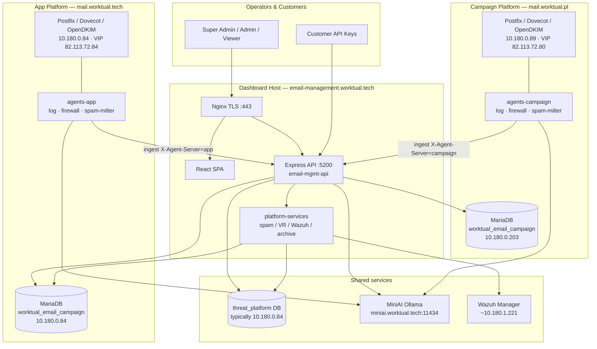
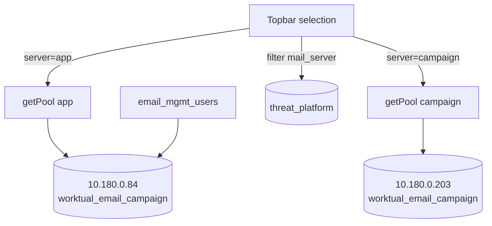
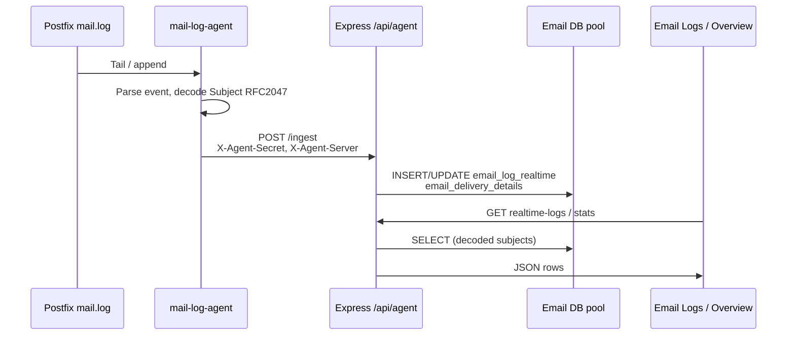
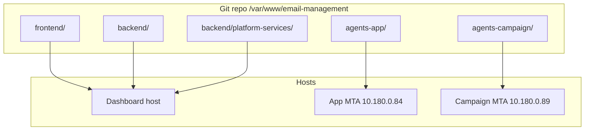

# Email Infra Management — Architecture

This document describes the **runtime architecture** of the Email Management application across the **App** and **Campaign** mail platforms. Diagrams use [Mermaid](https://mermaid.js.org/) (render in GitHub/Gitea, VS Code, or many Markdown viewers).

Related: [Application overview](./Email-Infra-Management-Application.md) · [App platform](./App-Platform.md) · [Campaign platform](./Campaign-Platform.md) · [DEPLOY.md](../DEPLOY.md)

---

## 1. High-level topology



---

## 2. Logical architecture (layers)

```mermaid
flowchart LR
  subgraph Presentation
    UI[React Dashboard<br/>Topbar App | Campaign]
  end

  subgraph Application
    REST[REST /api/*]
    AUTH[JWT + Roles]
    AGENT[Agent Secret Ingest]
    ORCH[AI Orchestration]
  end

  subgraph Domain
    DELIV[Delivery & Logs]
    SEC[Spam / Quarantine / Policies]
    TI[Threat Intel & Indicators]
    FW[Firewall & SIEM]
  end

  subgraph Data
    DB_APP[(Email DB · App)]
    DB_CAMP[(Email DB · Campaign)]
    DB_TP[(threat_platform)]
  end

  UI --> REST
  REST --> AUTH
  REST --> AGENT
  REST --> ORCH
  AUTH --> DELIV
  AUTH --> SEC
  AUTH --> TI
  AUTH --> FW
  AGENT --> DELIV
  AGENT --> FW
  DELIV --> DB_APP
  DELIV --> DB_CAMP
  SEC --> DB_APP
  SEC --> DB_CAMP
  SEC --> DB_TP
  TI --> DB_TP
  FW --> DB_TP
```

---

## 3. Dual-platform control plane

The Topbar passes `server=app|campaign` into APIs. Email metrics use **separate MariaDB hosts**; security data is shared and tagged.



| Concern | App | Campaign |
|---------|-----|----------|
| Realtime logs / delivery KPIs | App pool | Campaign pool |
| Quarantine / `app_settings` / policies | App pool | Campaign pool |
| Auth users | App pool only | — |
| Spam detections / TI / firewall / Wazuh | `threat_platform` + `mail_server` filter | same |

---

## 4. Mail log ingest path



Queue health:

```text
postqueue → POST /api/agent/queue-snapshot → postfix_queue_snapshot
         → Sidebar agent dots + Delivery Status
```

---

## 5. Spam milter & quarantine loop

```mermaid
flowchart LR
  SMTP[Inbound SMTP] --> MILTER[spam-milter :8891]
  MILTER --> PAT[Pattern rules]
  MILTER --> LLM[Ollama AI_MODEL_FAST]
  PAT --> DEC{Score}
  LLM --> DEC
  DEC -->|TAG| HDR[Add headers]
  DEC -->|QUARANTINE| Q[email_quarantine]
  DEC -->|REJECT| RJ[Reject]
  MILTER -->|notify| API[/api/spam/notification]
  API --> SD[(spam_detections)]
  UI[Quarantine Allow] --> WL[(spam_whitelist)]
  WL -->|/api/spam/whitelist/for-agent| MILTER
```

Default threshold bands (overridable per Topbar Policies): TAG **75** · QUARANTINE **85** · REJECT **95**.

---

## 6. Threat Intelligence waveform

```mermaid
flowchart TB
  SE[security_events] --> SUM[/api/connectors/summary]
  SP[spam_detections] --> SUM
  TI[threat_indicators] --> SUM
  SUM --> BUCKET{Window}
  BUCKET -->|≤ 48h| H[Hourly buckets]
  BUCKET -->|> 48h| D[Daily buckets]
  H --> CHART[Threat Intelligence<br/>AreaChart waveform]
  D --> CHART
```

KPIs can fall back to engine + spam counts when connector events are empty (`stats.source = engine+spam`).

---

## 7. AI orchestration path

```mermaid
flowchart TB
  UI[AI Orchestration page] --> OR[/api/orchestration/analyze]
  OR --> P1[Pattern / IOC / DNS]
  P1 --> P2[Ollama classify<br/>AI_MODEL / DEEP]
  P2 --> OUT[Threat type · confidence · explanation]
  NGX[Nginx] -.->|proxy_read_timeout 180s| OR
```

---

## 8. Component & deploy map



| Host | Deploy from | Key PM2 apps |
|------|-------------|--------------|
| Dashboard | `frontend` + `backend` + `platform-services` | `email-mgmt-api`, `platform-*` |
| App MTA | `agents-app` | `*-app` |
| Campaign MTA | `agents-campaign` | `*-campaign` |

---

## 9. Network reference

| Name | Address | Role |
|------|---------|------|
| Dashboard | `email-management.worktual.tech` | UI + API |
| App MTA | `10.180.0.84` / VIP `82.113.72.84` | Transactional mail |
| Campaign MTA | `10.180.0.89` / VIP `82.113.72.80` | Bulk mail |
| App / threat DB | `10.180.0.84` | Email KPIs (app) + `threat_platform` |
| Campaign DB | `10.180.0.203` | Email KPIs (campaign) |
| MiniAI | `miniai.worktual.tech:11434` | Ollama |
| Wazuh | `~10.180.1.221:55000` | SIEM API |

---

## 10. Security architecture notes

- JWT for humans; shared agent secret for machine ingest (rotate if ever exposed).  
- Rate limits on `/api/` and stricter limits on `/api/auth`.  
- Policies and quarantine are **per email DB pool** so App and Campaign thresholds stay independent.  
- Whitelist allow-list is global to milters but scoped by `mail_server` (`app` / `campaign` / `both`).  
- Do not commit live secrets in `ecosystem.config.js`; use `backend/.env` (see DEPLOY.md).

---

## 11. Repository layout (architecture view)

```text
email-management/
├── frontend/                 # React SPA
├── backend/
│   ├── server.js             # API entry :5200
│   ├── mailServers.js        # Dual-infra constants
│   ├── db.js / threatDb.js   # Pools
│   ├── routes/               # REST modules
│   ├── platform-services/    # Dashboard pollers (canonical)
│   └── *.sql                 # Schema helpers
├── agents-app/               # Deploy ONLY on App MTA
├── agents-campaign/          # Deploy ONLY on Campaign MTA
├── docs/                     # This documentation set
├── DEPLOY.md                 # Ops checklist
└── nginx.conf                # TLS + /api proxy
```
